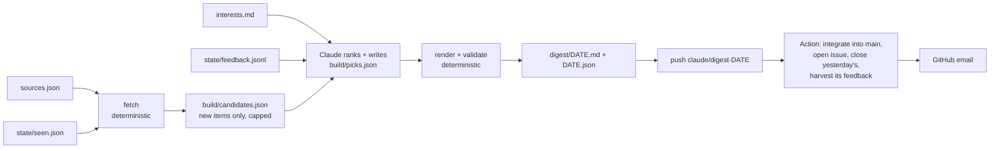
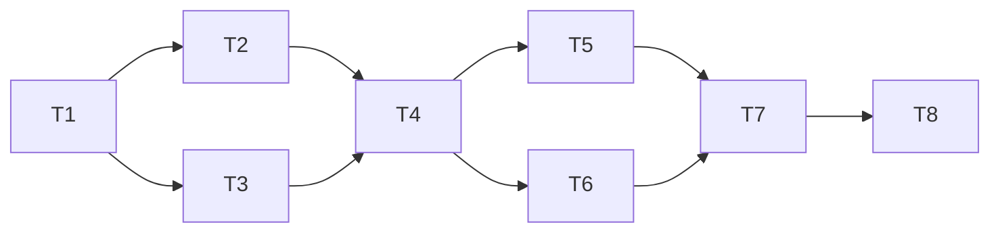

# tech-digest v1: daily personalised digest

- **Date:** 2026-10-23
- **Status:** Draft
- **Planned by:** Claude Opus 5.5 (desktop session)
- **Spec / source:** owner's setup request of 2026-10-23 ("Set up a new private repo, ryangswe/tech-digest")
- **Branch:** `digest-v1`

## Goal

Every morning the owner gets one email, a GitHub issue that reads in about 5 minutes: a "Top 3"
with why each matters to them, a one-line "Worth a skim" list and "Changed in my tools". Every item
links to its source and says nothing beyond what the source says. A deterministic stdlib-Python
step fetches and dedupes; Claude only ranks and writes. The owner ticks 👍/👎 boxes in the issue,
and once a week a run proposes `interests.md` edits as a PR.

**Not in v1:** Twitter/X, the bookmark-backlog import and the video pipeline (notes at the end);
full-article reading (Claude ranks from the feed's title, summary and signals such as HN points);
a web UI; any pip dependency.

## Approach

### Data flow



### The daily run (scheduled cloud task, fresh session)

The task's prompt is short and points at `prompts/daily.md` in the repo, so prompt changes are
versioned and reviewed. The steps:

1. `python3 -m techdigest fetch`: fetches every source (per-source timeout, failures isolated
   and listed, never fatal), normalises items, canonicalises URLs (lower-case host, strips
   `utm_*`/`ref`/fragments, arXiv ids without version), drops anything in `state/seen.json`,
   merges cross-source duplicates (an HN thread about a Simon Willison post becomes one item with
   both links and the HN points), applies each source's keyword filters, and caps the list (about
   150 items, summaries cut to about 300 characters) so the judgement step stays cheap.
2. Claude reads `interests.md`, a 30-day feedback summary (`python3 -m techdigest
   feedback-summary`) and the candidates, then writes `build/picks.json` (schema below).
3. `python3 -m techdigest render`: validates the picks and writes `digest/DATE.md` and
   `digest/DATE.json`. If validation fails, Claude fixes the picks and re-runs, at most 3 times.
4. `python3 -m techdigest mark-seen`: adds **every** fetched candidate to `state/seen.json` (not
   just the picked ones, or they would come back tomorrow) and prunes entries older than 60 days.
5. If `python3 -m techdigest status` says the weekly review is due (Mondays, with new feedback
   since the last proposal): edit `interests.md` on `claude/interests-DATE` from `origin/main`,
   push, open the PR with `gh api -X POST repos/ryangswe/tech-digest/pulls` (cloud sessions get
   403 on `gh pr`, so the REST call is used), and record the date in `state/weekly.json`.
6. Commit `digest/DATE.md`, `digest/DATE.json` and `state/` on `claude/digest-DATE` and push. The
   session never pushes `main`.

### Picks contract (`techdigest/picks.py`, Claude's only output)

```json
{
  "date": "2026-10-23",
  "opener": "One Morning Brew-style line.",
  "top":   [{"id": "<candidate id>", "headline": "...", "summary": "...", "why": "..."}],
  "skim":  [{"id": "...", "line": "..."}],
  "tools": [{"id": "...", "line": "..."}]
}
```

`render` rejects picks that: reference an unknown id; repeat an id; contain a URL (links come only
from fetched data, which is how "every item linked to its source" and "no invented links" are
enforced); have other than 3 `top` items (fewer only when there are fewer candidates); have more
than 10 `skim` or 6 `tools` items; or exceed about 1,100 words (5 minutes). `tools` may only use
candidates whose source is tagged `tool`. Claude's text cannot be checked against the source
mechanically. The prompt requires restating only what the candidate's title and summary say, and
"why it matters" is about the owner's interests, not claims about the item.

### Digest layout (`digest/DATE.md`, also the issue body)

```markdown
# ☕ Tech Digest — Thu 23 Oct 2026
_One-line opener._

## Top 3
### 1. Headline
Two-to-three sentence summary. **Why it matters to you:** one or two sentences.
[Source name](https://link) · [HN discussion, 412 points](https://news.ycombinator.com/item?id=…)

## Worth a skim
- **Headline**: one line. [Source](https://…)

## Changed in my tools
- **Claude Code 2.x.y**: what changed, one line. [Release notes](https://…)
_(or: "Nothing changed in your tools today.")_

<details><summary>👍 / 👎 — tick any, I learn weekly</summary>

- [ ] 👍 1 · Headline <!-- id:… -->
- [ ] 👎 1 · Headline <!-- id:… -->
</details>

<sub>42 new items from 19 sources · failed today: reddit (429)</sub>
```

Per-item emoji **reactions** are not possible on one issue: GitHub reactions attach to a whole
issue or comment, and one comment per item would send about 15 emails a day. So per-item feedback
is the tick boxes (they work in the issue page and the mobile app), plus a 👍/👎 reaction on the
issue as a whole and free-text comments ("more like #2"), all harvested.

### Delivery (GitHub Action, `.github/workflows/deliver.yml`)

Cloud sessions act on GitHub **as the owner**, and GitHub does not email you about your own
actions, so an issue Claude opened would arrive silently. The Action posts as
`github-actions[bot]` instead, which emails the owner as the repo's watcher. On a push to
`claude/digest-*`, with `contents: write` and `issues: write` set in the workflow file (no repo
setting changes):

1. `python3 -m techdigest integrate`: checks out `main`, takes from the branch **only**
   `digest/*.md`, `digest/*.json` and `state/{seen,weekly}.json` (anything else fails the run),
   re-validates the digest, and merges `seen.json` as a union so a race with another commit cannot
   lose entries.
2. `python3 -m techdigest deliver`: harvests the open digest issue's ticked boxes, its reactions
   and the owner's comments into `state/feedback.jsonl`, closes it, opens today's issue (label
   `digest`, body from the file), links any open `claude/interests-*` PR in the body, commits to
   `main` and deletes the branch.
3. On failure, it opens a "Digest run failed" issue with the log tail, so a broken run still emails.

A second schedule in the same workflow (09:15 Central) opens a "No digest today" issue if no digest
landed. Per the cloud-task docs, a green run status does not prove the work succeeded.

The GitHub calls go through a small stdlib `urllib` client, so the logic is unit-tested against a
fake. Actions minutes are about 1 a day, well inside the private-repo free tier.

### Sources (`sources.json`, stdlib JSON instead of YAML)

Each source has a `type` (`feed` for RSS/Atom, `hn`, `arxiv`, `html_links`, `page_watch`),
optional `include`/`exclude` keywords, a per-day cap, and `tags` (`tool` marks "Changed in my
tools" sources). Every URL below returned data on 2026-10-23 unless marked.

| Source | How | Why |
|---|---|---|
| Anthropic news | `html_links` on anthropic.com/news (no RSS; links and titles are in the page) | Model releases, pricing, policy. `tool` |
| Anthropic Engineering | `html_links` on anthropic.com/engineering | Harness, context and eval write-ups |
| Claude Code releases | github.com/anthropics/claude-code/releases.atom | Exact changelog per version. `tool` |
| Simon Willison | simonwillison.net/atom/everything/ | Best single feed on LLM tooling and pricing |
| HN front page | Algolia `tags=front_page` (one call, with points and comments) | General signal |
| HN keyword search | Algolia `search_by_date`, last 24 h, ≥30 points, keywords from your topics | Catches topic stories that miss the front page |
| Reddit | **one** combined feed: r/ClaudeAI+ClaudeCode+LocalLLaMA+RiftboundTCG+OnePieceTCG, top of the day | Community practice; best effort (see Risks) |
| YouTube | channel feeds: Anthropic, AI Engineer, Latent Space, AI Explained | Talks and releases; titles only |
| arXiv | export.arxiv.org API, cs.AI + cs.CL **+ cs.SE**, keyword query, capped at 10 | cs.SE is where coding-agent papers land |

**Proposed additions** (say no to any):

| Source | Why |
|---|---|
| Latent Space (latent.space/feed) | AI-engineering interviews with tool builders |
| Hugging Face blog | On-device and in-browser models, transformers.js |
| transformers.js releases (GitHub atom) | Your in-browser ML stack. `tool` |
| Chrome for Developers blog + Mozilla Add-ons blog | Extension platform and store policy announcements |
| `page_watch` on the Chrome Web Store program policies and AMO add-on policies pages | An item only when the page text changes: rare and high-signal |
| `html_links` on the Riftbound news page and the One Piece TCG news page | Official announcements, rules and policy (no RSS on either) |
| OpenAI news, Google DeepMind blog (capped at 2 a day each) | "Others briefly" for model releases |
| Show HN with ≥100 points (Algolia) | Indie and solo-developer launches |

Rejected: GitHub Changelog (too noisy for its signal); Indie Hackers (its feed returns 403).

### Time zone and schedule

Use **America/Chicago** (your Mac's zone). The scheduler takes daily times in your local zone, and
`sources.json` sets the same zone so the digest's date matches your morning. Run at **06:37**:
off the hour, because the docs say on-the-hour runs can start late, and after arXiv's overnight
announcement.

## Alternatives considered

- **Claude opens the issue with `gh api`**: rejected because it posts as you, so no email arrives
  without the "Include your own updates" setting, which also emails you about every comment you
  write anywhere.
- **The session pushes straight to `main`**: the cloud proxy allows it, but it would break the
  repo rule and give an unattended run write access to code. The Action's path allowlist keeps
  runs to `digest/` and `state/`.
- **Claude writes the Markdown directly**: rejected; structured picks plus a deterministic
  renderer make the format testable and keep links out of Claude's hands.
- **YAML sources file**: needs PyYAML or a hand-rolled parser; JSON is stdlib.
- **A separate weekly scheduled task**: the daily run checks `status` instead, which saves you a
  setup step.

## Risks and open questions

- **Reddit blocks unauthenticated fetches** (429 on the second request from your Mac; cloud IPs
  are likelier still to be blocked). Mitigation: one combined request with a descriptive
  User-Agent, failures listed in the footer. If it fails daily, drop it or add Reddit OAuth (free,
  but a secret and an owner step).
- **Page-watch noise**: dynamic page markup can change the hash without a policy change. It will
  hash the extracted main text, and if that is still noisy the watch gets dropped.
- **Feed formats drift** (anthropic.com has no feed and its markup can change). Each source's
  item count is logged, and a source that returns 0 items three days running is flagged in the
  footer.
- **Time zone data in the cloud image**: `zoneinfo` needs system tzdata. If it is missing, the
  code falls back to a fixed −05:00/−06:00 rule for Chicago and logs it.
- **Open questions for you:**
  1. Which extensions should "Changed in my tools" follow beyond Claude Code and the models (for
     example Claude in Chrome, VS Code extensions)? Each needs a feed, release page or `page_watch` URL.
  2. Riot's Riftbound community-tool policy page URL, and Bandai's for One Piece TCG, if you know
     them, for `page_watch`.
  3. Which model should the scheduled task use? I suggest **Sonnet 5.5** (cheaper on your
     subscription, ample for ranking about 150 items). Switch to Opus 5.5 if "why it matters"
     reads generic.

## Dependency summary



- **Parallel group A:** T2, T3 (after T1)
- **Parallel group B:** T5, T6 (after T4)
- **Integration order:** T1 → T2 → T3 → T4 → T5 → T6 → T7 → T8, one lead session on `digest-v1`.

## Task graph

### T1 — Skeleton, sources and interests

- **Status:** Pending
- **Dependencies:** None
- **Parallel group:** Sequential
- **Complexity:** ROUTINE
- **Execution:** Lead session
- **Owner time:** about 20 min, any time before go-live: edit `interests.md` (drafted with this plan)
- **Expected files/workspaces:** `techdigest/__init__.py`, `techdigest/__main__.py`, `sources.json`, `interests.md`, `.gitignore`, `README.md`
- **Objective:** package layout, CLI entry with subcommands, `sources.json` with the sources above, and a config loader that validates it.
- **Success criteria:**
  - `python3 -m techdigest --help` lists the subcommands
  - an invalid `sources.json` fails with the offending source named
- **Verification:**
  - `python3 -m unittest tests.test_config`
- **Escalate if:**
  - a source needs a paid key or an account

### T2 — Fetchers and normalisation

- **Status:** Pending
- **Dependencies:** T1
- **Parallel group:** A
- **Complexity:** STRONG
- **Execution:** Lead session
- **Owner time:** None
- **Expected files/workspaces:** `techdigest/fetch.py`, `techdigest/parse.py`, `techdigest/urls.py`, `fixtures/feeds/*`, `tests/test_parse.py`
- **Objective:** an HTTP getter (User-Agent, gzip, timeout, retry once, arXiv 3-second spacing); parsers for RSS 2.0, Atom (GitHub, YouTube, Reddit, arXiv), HN Algolia JSON, `html_links` and `page_watch`; URL canonicalisation; keyword filters; cross-source merge; the cap. A `--fixtures DIR` switch reads saved files instead of the network. Fixtures are small synthetic files in each real format, not copies of third-party content.
- **Success criteria:**
  - each parser yields the expected items from its fixture, including CDATA, HTML entities, a missing date and a relative link
  - one failing source does not stop the others and is listed in `fetch-report.json`
- **Verification:**
  - `python3 -m unittest tests.test_parse`
- **Escalate if:**
  - a source's HTML cannot be parsed reliably without a third-party library

### T3 — Seen-state and dedupe

- **Status:** Pending
- **Dependencies:** T1
- **Parallel group:** A
- **Complexity:** ROUTINE
- **Execution:** Lead session
- **Owner time:** None
- **Expected files/workspaces:** `techdigest/state.py`, `state/seen.json`, `tests/test_state.py`
- **Objective:** `seen.json` as `{key: first_seen_date}`, sorted for small diffs; filter, mark, prune after 60 days, union merge.
- **Success criteria:**
  - an item seen yesterday is dropped; one first seen 61 days ago is pruned and can return
  - the union merge keeps the earliest date for each key
- **Verification:**
  - `python3 -m unittest tests.test_state`
- **Escalate if:**
  - None expected

### T4 — Picks contract, renderer and dry run

- **Status:** Pending
- **Dependencies:** T2, T3
- **Parallel group:** Sequential
- **Complexity:** STRONG
- **Execution:** Lead session
- **Owner time:** about 5 min: read the sample digest and say if the tone or layout is off
- **Expected files/workspaces:** `techdigest/picks.py`, `techdigest/render.py`, `techdigest/rank_keywords.py`, `techdigest/dryrun.py`, `tests/test_render.py`, `examples/sample-digest.md`
- **Objective:** validate picks, render the layout above, a keyword ranker that stands in for Claude offline, and `dry-run`: fixtures → fetch → keyword picks → render to `build/dry-run/`, never touching the committed `state/`.
- **Success criteria:**
  - every rejection rule in "Picks contract" has a test
  - the rendered digest has the three sections, a link on every item and a feedback box per item
  - `python3 -m techdigest dry-run` works with networking off
- **Verification:**
  - `python3 -m unittest tests.test_render`
  - `python3 -m techdigest dry-run && cat build/dry-run/*.md`
- **Escalate if:**
  - the 5-minute budget cannot hold 3 + 10 + 6 items, in which case the caps change

### T5 — Delivery Action and feedback harvest

- **Status:** Pending
- **Dependencies:** T4
- **Parallel group:** B
- **Complexity:** STRONG
- **Execution:** Lead session
- **Owner time:** None
- **Expected files/workspaces:** `techdigest/github.py`, `techdigest/deliver.py`, `techdigest/integrate.py`, `.github/workflows/deliver.yml`, `tests/test_deliver.py`
- **Objective:** integrate (path allowlist, seen union), deliver (harvest, close, open, link interests PRs), the failure issue and the no-digest check, all through a fakeable GitHub client.
- **Success criteria:**
  - a branch touching any other path is refused
  - ticked boxes, the issue's reactions and owner comments become `feedback.jsonl` lines with the item id and date
  - running deliver twice for one date opens one issue, not two
- **Verification:**
  - `python3 -m unittest tests.test_deliver`
  - after merge: a manual `claude/digest-test` push from your Mac produces an issue email (end-to-end check)
- **Escalate if:**
  - `GITHUB_TOKEN` cannot push to `main` (for example, a ruleset), which would need an owner setting

### T6 — Weekly feedback review

- **Status:** Pending
- **Dependencies:** T4
- **Parallel group:** B
- **Complexity:** ROUTINE
- **Execution:** Lead session
- **Owner time:** about 5 min a week from go-live: review the PR
- **Expected files/workspaces:** `techdigest/feedback.py`, `state/weekly.json`, `tests/test_feedback.py`
- **Objective:** `feedback-summary` (per-source and per-topic votes, quoted comments) and `status` (whether the weekly review is due).
- **Success criteria:**
  - due on a Monday with new feedback since the last proposal; not due otherwise
- **Verification:**
  - `python3 -m unittest tests.test_feedback`
- **Escalate if:**
  - None expected

### T7 — Prompt, setup guide and decisions

- **Status:** Pending
- **Dependencies:** T5, T6
- **Parallel group:** Sequential
- **Complexity:** STRONG
- **Execution:** Lead session
- **Owner time:** None
- **Expected files/workspaces:** `prompts/daily.md`, `docs/setup.md`, `docs/decisions.md`, `docs/decisions/architecture.md`, `README.md`
- **Objective:** the full run procedure with failure rules (no questions, no pushes to `main`, stop after 3 failed renders and push nothing), the owner setup checklist, and decision entries for the bot-delivery and path-allowlist choices.
- **Success criteria:**
  - a fresh session given only the scheduled-task prompt can follow `prompts/daily.md` end to end in dry-run mode
- **Verification:**
  - `python3 .claude/workflow/check.py`
- **Escalate if:**
  - None expected

### T8 — Checkpoint, review and live smoke test

- **Status:** Pending
- **Dependencies:** T7
- **Parallel group:** Sequential
- **Complexity:** ROUTINE
- **Execution:** Lead session + `reviewer` agent
- **Owner time:** None
- **Expected files/workspaces:** none new
- **Objective:** `/checkpoint`, a fresh-context review of the whole diff, then a live `fetch` from the Mac (not committed) to confirm each source parses real data today.
- **Success criteria:**
  - tests and the workflow check pass; the reviewer's material findings are fixed; every source returns items or has a known reason not to
- **Verification:**
  - `python3 -m unittest discover -s tests && python3 .claude/workflow/check.py`
  - `python3 -m techdigest fetch --out build/live && cat build/live/fetch-report.json`
- **Escalate if:**
  - a required source fails live

## Execution strategy

- **Lead/orchestrator owns:** everything. It is one small package, and the parallel groups share
  `techdigest/` and the tests, so concurrency would save little and risk conflicts.
- **Delegated tasks:** None beyond the `reviewer` (T8) and `Explore` lookups.
- **Model routing:** Opus 5.5 lead; Sonnet 5.5 suggested for the daily scheduled run.
- **Owner time, total:** about 50 min once (interests about 20, setup about 20, first-run check
  about 10), then about 5 min a week for the interests PR.
- **Approval gates:**
  - owner approval of this plan before code is written
  - owner says when to open the PR (none is opened before then)
- **Review strategy:** a fresh `reviewer` pass on the full `digest-v1` diff at T8.

### Concurrency and isolation

| Task | Actually concurrent with | Worker/session | Writes files? | Branch/base | Isolation | Shared mutable resources | Integration |
|---|---|---|---:|---|---|---|---|
| T1–T8 | None | Lead | Yes | `digest-v1` | Main checkout | None | Direct |

## Owner setup steps (only you can do these)

About 20 minutes, after v1 is merged. Exact clicks go in `docs/setup.md` (T7).

1. **Claude GitHub App on this repo**: github.com/apps/claude → Configure → add
   `ryangswe/tech-digest` (skip if it already has access to all repositories). This lets cloud
   sessions clone a private repo.
2. **Cloud environment**: claude.ai/code → environment settings → new environment `tech-digest` →
   Network access **Custom**, keep "Also include default list of common package managers" ticked
   (it covers github.com, api.github.com and raw.githubusercontent.com), and paste these allowed
   domains:
   ```
   www.anthropic.com
   simonwillison.net
   hn.algolia.com
   www.reddit.com
   www.youtube.com
   export.arxiv.org
   www.latent.space
   huggingface.co
   developer.chrome.com
   blog.mozilla.org
   extensionworkshop.com
   openai.com
   deepmind.google
   riftbound.leagueoflegends.com
   en.onepiece-cardgame.com
   ```
   (Drop the lines for any proposed source you reject.) No environment variables or secrets are
   needed.
3. **Scheduled task**: claude.ai/code/routines → New task → Set up manually. Name
   `tech-digest daily`; repository `ryangswe/tech-digest`; environment `tech-digest`; schedule
   Daily **06:37**, entered in your local zone, **America/Chicago**; model Sonnet 5.5; remove every
   connector (none is needed); prompt:
   ```
   You are the scheduled daily run of ryangswe/tech-digest, in a fresh clone of the repository.
   Read CLAUDE.md, then follow prompts/daily.md exactly, step by step. This run is unattended:
   never ask questions, never push to main, never open a PR except the weekly interests PR that
   prompts/daily.md describes, and never edit any file outside digest/, state/ and build/ (plus
   interests.md, only on a claude/interests-* branch). If a step fails, follow the failure rules
   in prompts/daily.md and end the run.
   ```
4. **Notifications**: github.com/settings/notifications → "Watching" has Email ticked (the
   default). The repo's Watch button should show Watching or All Activity.
5. **First run**: on the task, Run now → within about 10 minutes an issue email arrives.

## Out of scope for v1 (notes, not built)

### Twitter/X

Researched on 2026-10-23. X's pricing changed in 2026, so check again before buying.

| Option | Cost | Fit |
|---|---|---|
| **X API, pay-per-use** (default since 2026-02-06; no free tier, $20 starting credit) | Your own bookmarks, lists and mentions are "owned reads" at about $0.001 each; other people's posts about $0.005 each. Reading 200 list posts a day is about $30/mo; syncing your bookmarks is cents. | Official. A poor fit for stateless runs: the OAuth 2.0 user token expires and its refresh token rotates on every use, so something must store the new token after each run. A cloud session can't do that safely, and an Action can't update its own secrets without a PAT. |
| **Readwise** (Full plan $9.99/mo billed yearly; 30-day trial) | Daily X bookmark sync (marked "experimental"), plus "@readwise save thread". | Best fit. Its API takes one static token, which works as a cloud-environment network secret, and `updatedAfter` filtering suits a daily pull. Adds 1 host, 1 secret and about 10 min of your time. |
| **Manual export** (bookmark, then a weekly paste into `inbox/x.md`) | Free | Zero setup and zero risk, but it depends on you remembering. |
| Tweetsmash ($7/mo; API on the $99/yr plan), Dewey ($10/mo) | as stated | Tweetsmash's sync uses the official API. Their full-history imports and Dewey read your logged-in browser session, a grey area under X's terms. |

**Recommendation for v2:** start with Readwise's trial, and add a `readwise` source type that
reads items tagged from X.

### One-time bookmark-backlog import

What it needs, cheapest first:

1. **Request your X data archive** (Settings → Your account → Download an archive). Sources
   disagree on whether it holds a `bookmarks.js`, and some say that file has only tweet ids, so
   check your own copy. It is free and takes minutes to days.
2. **The official API returns only about the 800 most recent bookmarks** (widely reported, not in
   X's docs). At owned-read prices that is under $1, using the $20 starting credit, with a one-off
   OAuth sign-in from your Mac. The rotating-token problem doesn't apply to a single run.
3. **Older than about 800:** if the archive has ids, look them up through the API at about $0.005
   each (about $15 for 3,000; the billing rate is unverified). Otherwise only session-based tools
   reach them (Readwise's extension backfill, Tweetsmash, Dewey), which is your call under X's terms.
4. **Then** a one-off local session clusters the posts by topic and writes
   `reports/bookmarks-summary.md` ("what's in my bookmarks", with the themes, the standout threads
   and which topics belong in `interests.md`). That is a few hours of work once the data is in hand.

**Your time:** about 15 min to request the archive and about 15 min for the OAuth sign-in, plus
about $1–15.

### Short videos from the digest

A separate project that consumes this one. Here, the contract is already in place: each day's
`digest/DATE.json` holds the picks, ids, headlines, summaries and source links as structured data,
so a video repo can read it (git submodule, or a scheduled fetch of `raw.githubusercontent.com`)
without parsing Markdown. That project would add script writing, voice, visuals, rendering and
upload, with its own costs (TTS, rendering, YouTube API quota) and an editorial gate before
anything is published. It needs only one thing from this repo: keep `DATE.json` stable, by adding
a `schema_version` field in T4.

## Execution log

Kept in `2026-10-23-digest-v1-log.md` once work starts.

## Integration and verification

### Integrated checkpoint

- [ ] `/checkpoint` completed (tests → workflow check → dry run)
- [ ] Any checkpoint failures resolved and the checkpoint rerun

### End-to-end acceptance

- [ ] `python3 -m techdigest dry-run` produces a digest from fixtures with networking off
- [ ] A live `fetch` from the Mac returns items from every required source, or the reason it can't
- [ ] Invalid picks (unknown id, URL in text, too long) are refused with a clear message

### Independent review

- **Reviewer:** `reviewer` agent (Opus)
- **Verdict:** Pending
- **Findings:** —
- [ ] Material findings resolved
- [ ] Relevant verification rerun after fixes

## Completion summary

- **Delivered:** —
- **Deviations from approved plan:** —
- **Known risks / follow-up:** —
- **Decision records updated:** —
- **Lesson:** —
