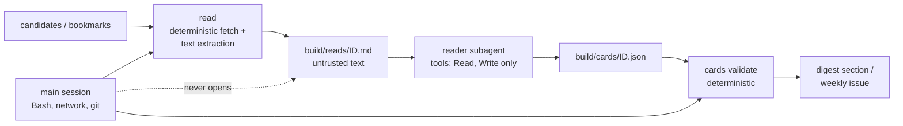
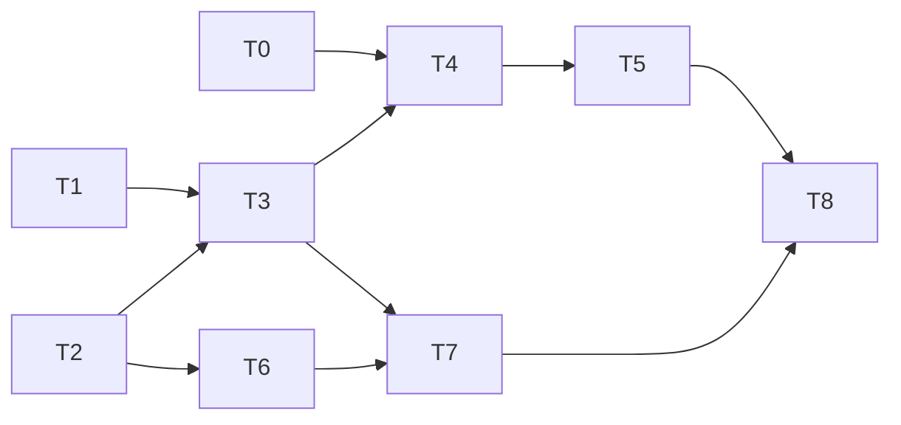

# tech-digest v2: a reviewer that says what's worth trying, and a bookmark-backlog triage

- **Date:** 2026-10-24
- **Status:** In progress (approved by the owner 2026-10-24: Full network access; main posts only, no thread handling; projects as below)
- **Planned by:** Claude Opus 5.5 (desktop session, after v1 shipped)
- **Spec / source:** the owner, 2026-10-24: they want agents that review items, "summarize the
  important bits, and share anything that I could potentially use/implement" (workflow
  improvements, skills, projects to try), and help with a large X bookmark backlog they cannot
  read item by item. They have requested their X data archive.
- **Branch:** `v2-reviewer` (T0 also on `v1-cloud-fixes`, which can merge on its own)

## Goal

v1 answers "what's new?". v2 answers "what should I do about it?":

1. **Action cards.** A reviewer reads the full source of the day's most relevant items, and of
   anything the owner ticks 🔍, then writes a short card: what it is, what to try, how long that
   takes, and where it fits in the owner's setup.
2. **A weekly "Try this" issue** gathers the week's cards into a ranked, tickable list.
3. **A one-off triage of the X bookmark backlog**, run locally: import, expand links, sort every
   bookmark into skip / note / try / deep-dive, then a themed "what's in my bookmarks" report. The
   "try" items feed the weekly issue a few at a time.

It also fixes three things v1's first cloud run showed.

**Not in v2:** agents opening PRs in other repositories (a card can say "candidate for
claude-workflow", and the owner starts that session); videos; ongoing X sync (decided after the
backlog, from what the archive contains); reading X itself (x.com needs a login and JavaScript, so
post text comes only from the archive or the API).

## What v1's first cloud run showed (2026-10-24)

- **Claude Code releases** and **transformers.js releases** failed with `HTTP 403`. In cloud
  sessions github.com allows only git operations through the GitHub proxy, so `releases.atom` is
  blocked. "Changed in my tools" was empty.
- **Latent Space** and **Riftbound news** failed with `Tunnel connection failed: 403`: their hosts
  are probably missing from the environment's allowlist.
- YouTube's feeds **worked** from the cloud, although they 404ed from the Mac.
- Otherwise it worked: 59 candidates from 20 of 24 sources, delivered at 06:38, and the watchdog
  was quiet.

## Approach

### The trust problem, and the quarantine that answers it

A reviewer that reads arbitrary web pages and bookmarked posts reads text written by strangers,
and such text can contain instructions aimed at agents. The daily session has a shell, network
access and push rights. So v2 splits the work:



- **Fetching is code:** `python3 -m techdigest read` downloads and extracts the text, caps it at
  about 30,000 characters, and writes it to `build/reads/` with a header marking it untrusted.
- **Only a quarantined subagent reads it:** `.claude/agents/reader.md`, whose `tools:` are just
  Read and Write. It has no shell and no network, so injected text cannot run anything or send
  anything anywhere. It writes one card JSON per item, and puts any instruction-like text it
  notices in the card's `flags` field instead of following it.
- **Cards are validated like picks:** the id must exist, there are length caps, there are no
  URLs (links come from data), and `next_step` cannot contain shell commands, so a malicious page
  cannot plant a `curl … | sh` in your inbox. Flagged cards are shown with a warning.
- **The main session never opens `build/reads/`.** It runs commands and reads only validated
  cards. The v1 path allowlist still guards what reaches `main`.

### Daily: cards for the top items and your 🔍 requests

1. The digest gains a third tick box per item, **🔍 dig in**.
2. The daily run calls `python3 -m techdigest dig-requests`. It reads the open digest issue
   through `gh api` (REST, which the cloud allows for this repository) and lists the items you
   ticked 🔍. Those are answered the next morning, a one-day lag.
3. The run picks today's top 3 plus yesterday's 🔍 items (6 at most), runs `read`, hands the
   texts to the reader subagent, and validates the cards.
4. The digest gains a **🧪 Worth trying** section: one or two lines per card, with effort and fit,
   below Top 3. Full cards go into `digest/DATE.json` for the weekly issue.

### Weekly: the "Try this" issue (Mondays, inside the daily run)

- `reviews/YYYY-Www.{json,md}`: the week's cards for items you 👍'd or 🔍'd plus the top-scored
  rest, and up to 5 cards from the bookmark queue. Ranked by fit and effort, each with
  ☐ done / ☐ later / ☐ not for me boxes.
- The delivery Action opens it as a separate issue (label `try-this`) and closes last week's after
  harvesting its ticks into `state/feedback.jsonl`. "Not for me" and "done" also steer the
  `interests.md` proposals.
- No new scheduled task: the daily run's existing Monday branch (`status` → `weekly_review_due`)
  is extended.

### Card contract (`techdigest/cards.py`)

```json
{
  "id": "<candidate or bookmark id>",
  "kind": "try | adopt | watch | read-later",
  "what": "≤ 60 words: what the source says it is or does",
  "why_you": "≤ 60 words: why it matters to this owner, from profile.md and interests.md",
  "next_step": "≤ 40 words: one concrete first step, plain prose, no commands",
  "effort": "15m | 1h | half-day | project",
  "fits": ["workflow kit", "Gradientless", "Cardvision", "..."],
  "confidence": "high | medium | low",
  "flags": ["optional: instruction-like text noticed in the source"]
}
```

`fits` values must come from `profile.md`'s project list. "what" restates the source, the v1 rule;
"why_you" and "next_step" are judgement.

### `profile.md`: what the reviewer measures items against

A short, owner-edited file next to `interests.md`. `interests.md` says what to show; `profile.md`
says what you already have, so the reviewer can say "this would replace X" or "you already do
this". The draft will list:

- your Claude Code setup: the workflow kit (light/full), CLAUDE.md conventions, scheduled tasks,
  subagents, skills;
- active projects, one or two lines each (the owner's list, 2026-10-24): RiftSight and
  riftsight-vision, Kenbunshoku, DuelSight, StackDepth, Vantle, cardvision-hq, tech-digest and
  the workflow kit. Gradientless is archived and left out;
- the stack: TypeScript, Python, browser extensions, ONNX/wasm;
- what you've already tried or ruled out (empty at first; the weekly "done" and "not for me"
  ticks suggest additions).

**The repository is public** (it changed after v1 was planned), so `profile.md` describes each
project only as far as its public README or site does. Private repos (RiftSight, StackDepth) get
a one-line public-level description. The weekly issue and the cards are public like the digest.
It is drafted from the repos' READMEs and `cardvision-hq/CONTEXT.md`; you correct it.

### The bookmark backlog (local, one-off)

It runs on the Mac, where the archive lands, in a local Claude Code session. Raw bookmark text
stays out of git (`backlog/raw/` is gitignored); only decisions and reports are committed.

1. **Import** (`python3 -m techdigest backlog import <archive.zip | api-pages/ | readwise-export>`).
   The parser supports the X archive's `data/bookmarks.js` if present (sources disagree on whether
   the archive includes bookmarks, and on whether it holds full text or only ids), X API bookmark
   pages, and a Readwise export. Each bookmark becomes `{id, author, text, created, urls[], media}`,
   with t.co links taken already expanded from the archive's `entities`.
2. **Read links:** `read` fetches each bookmark's linked article or repo README. Most bookmarks
   are a link plus a comment, and the link is the substance. Dead links, x.com-only links and
   media-only posts are kept with their text alone.
3. **Batch:** deduplicate (same URL, same thread) and split into batches of about 40.
4. **Triage:** parallel quarantined `triage` subagents (Read and Write only, Sonnet 5.5), one per
   batch. Each writes `backlog/triage/batch-NNN.json`: verdict (skip / note / try / deep-dive), a
   topic, a one-line reason, and a card for try and deep-dive items. `backlog validate` checks
   each file. A batch file is a checkpoint, so the run resumes where it stopped across sittings.
5. **Report:** `backlog report` writes `reports/bookmarks-summary.md`: themes with counts, the
   standouts per theme, what you bookmark that `interests.md` doesn't cover, and sources worth
   adding to `sources.json`. It also writes `backlog/queue.json` (try and deep-dive cards, ranked),
   which the weekly issue drains at 5 a week. You can also just read the whole queue.

**If the archive has no bookmark text**, only ids or no `bookmarks.js` at all, there are two
fallbacks, each needing your go-ahead because they cost money or need an account:

- the X API: about $1 for the newest ~800 bookmarks, about $0.005 per post to look up older ids;
- Readwise: $9.99 a month, with a 30-day trial that covers a one-off.

### Fixes to v1 (T0)

- **Claude Code changelog:** a `changelog_md` source type reading
  `raw.githubusercontent.com/anthropics/claude-code/main/CHANGELOG.md` (allowed by default). Each
  `## <version>` heading is an item, keyed `changelog:claude-code:<version>`, and the first sight
  bootstraps as for listing pages. The bullets become the summary, so tool lines get real content.
- **transformers.js:** versions and dates from `registry.npmjs.org/@huggingface/transformers`
  (allowed by default), linking to the GitHub release page.
- **The allowlist:** add or fix `www.latent.space` and `riftbound.leagueoflegends.com` (owner).

### Network

`read` needs to reach any article host, which the Custom allowlist cannot list in advance. Two
options:

- **A (recommended): Full network access.** Combined with the quarantine, only deterministic code
  fetches, and only the tool-less subagent reads what comes back. Nothing to maintain.
- **B: stay on Custom**, and `read` marks items on unlisted hosts "not read" (their cards then
  rest on the title and summary). This is safer by default, but most cards get thinner, and you
  would add hosts by hand.

## Alternatives considered

- **Letting the main session read pages (WebFetch or curl):** rejected. The agent that holds the
  shell and push rights would be reading attacker-controlled text.
- **Running the reviewer in GitHub Actions with the Claude Code Action:** that gives an open
  network outside the cloud environment, but needs a long-lived OAuth token as a repository
  secret, and would be a second agent runtime to maintain. Kept as a fallback if Full access is
  unwanted.
- **Separate repositories for the reviewer and the backlog:** rejected. They share sources,
  feedback, `interests.md`, the card contract and the weekly issue.
- **Triaging the backlog in the cloud:** rejected. The archive is a personal file on the Mac and
  should not be uploaded or committed; a local session also avoids the network question.
- **One giant bookmark report only:** a 3,000-item report is the same problem in a new shape. The
  report is kept short (themes and standouts), and the actionable items drip weekly.

## Risks and open questions

- **What the archive contains:** this decides T6's parser and whether a paid fallback is needed.
  T6 starts by inspecting the real file. If it lacks bookmarks or their text, T6 escalates before
  writing the parser.
- **Threads:** settled by the owner (2026-10-24). Only the bookmarked main post and its links
  matter; replies are noise. No thread expansion, no Readwise.
- **Public repository:** the bookmark report and queue would be public if committed here. Where
  they live (here, or a private repo such as cardvision-hq, or `~/Downloads/Cardvision/`) is
  decided with the owner at T6, before anything is committed.
- **Branch protection is now free** (public repo): a ruleset on `main` that only the delivery
  workflow may bypass would turn the v1 path allowlist from a guardrail into enforcement. It is
  an owner-only setting, suggested but not part of this plan.
- **Usage:**
  - **Daily:** about 3 to 6 page reads plus cards add about 40–80k tokens a run, small next to
    v1's run.
  - **Backlog:** assuming 3,000 bookmarks, about half with a link, triage reads roughly 3–5M
    tokens of extracted text over 75 batches. On a Max plan that is 2 or 3 sittings; on Pro it
    could take several days of the usage window. The batch checkpoints make stopping safe.
- **Extraction quality:** stdlib-only article extraction (main-text heuristics, `<article>`,
  `<main>`, densest block) will be imperfect on JavaScript-heavy sites. Those cards fall back to
  title and summary and say so (`confidence: low`).
- **🔍 requests through `gh api` from the cloud:** documented as supported for REST on attached
  repositories, but not yet verified for this task. If it fails, 🔍 requests are read from
  `state/feedback.jsonl` after delivery, a two-day lag.
- **Answered 2026-10-24:** network A (Full); bookmark count unknown, main posts only; projects:
  remove Gradientless, add DuelSight and StackDepth. Weekly size: about 10 cards (5 + 5) by default.

## Dependency summary



- **Parallel group A:** T0, T1, T2 (independent).
- **Parallel group B:** T4 and T6 (after T3 and T2).
- **Integration order:** T0 → T1 → T2 → T3 → T4 → T5 → T6 → T7 → T8, on `v2-reviewer`. T0 can
  ship as its own small PR first, since it fixes today's empty tool section.

## Task graph

### T0 — v1 fixes from the first cloud run

- **Status:** Pending
- **Dependencies:** None
- **Parallel group:** A
- **Complexity:** ROUTINE
- **Execution:** Lead session
- **Owner time:** 5 min: check the two allowlist hosts
- **Expected files/workspaces:** `techdigest/parse.py`, `techdigest/config.py`, `sources.json`, `fixtures/build.py`, `tests/test_parse.py`, `docs/setup.md`
- **Objective:** the `changelog_md` source type for Claude Code, the npm registry for
  transformers.js, and a setup-doc note on the two hosts.
- **Success criteria:**
  - a changelog fixture yields one item per version, with bullet text as the summary; first sight bootstraps
  - a live fetch from the Mac returns Claude Code versions from raw.githubusercontent.com
- **Verification:**
  - `python3 -m unittest discover -s tests`
- **Escalate if:**
  - raw.githubusercontent.com is also refused in the cloud (the next run's footer shows it)

### T1 — `profile.md`

- **Status:** Pending
- **Dependencies:** None
- **Parallel group:** A
- **Complexity:** ROUTINE
- **Execution:** Lead session
- **Owner time:** about 20 min: correct the draft
- **Expected files/workspaces:** `profile.md`, `CLAUDE.md` (layout line)
- **Objective:** the profile described above, drafted from what earlier sessions recorded, with
  the project list that `fits` validates against.
- **Success criteria:**
  - a machine-readable project list (a `## Projects` section of `- Name: one line` entries) that `cards.py` reads
- **Verification:**
  - `python3 -m unittest tests.test_cards` (after T3)
- **Escalate if:**
  - the owner wants anything kept out of the repository

### T2 — `read`: deterministic full-text fetch

- **Status:** Pending
- **Dependencies:** None
- **Parallel group:** A
- **Complexity:** STRONG
- **Execution:** Lead session
- **Owner time:** None
- **Expected files/workspaces:** `techdigest/read.py`, `fixtures/reads/*`, `tests/test_read.py`
- **Objective:** given item ids (from candidates or the backlog), fetch and extract readable text.
  Articles use `<article>`/`<main>`/densest-block heuristics; GitHub repos use the raw README;
  arXiv uses the abstract page; PDFs, x.com and media are skipped with a reason. Each result goes
  to `build/reads/ID.md` behind an untrusted-content header, capped at about 30k characters, with
  a per-run cache and a polite rate limit.
- **Success criteria:**
  - extraction fixtures (a blog post with navigation and comments, a GitHub repo, an arXiv page, a JS-only page) give the main text or a clear "not readable" reason
  - each fetch is isolated: a failure becomes `status: failed` for that id and never stops the run
- **Verification:**
  - `python3 -m unittest tests.test_read`
- **Escalate if:**
  - stdlib extraction is unusable on most real pages in a live sample of 20

### T3 — Card contract and the quarantined reader

- **Status:** Pending
- **Dependencies:** T1, T2
- **Parallel group:** Sequential
- **Complexity:** STRONG
- **Execution:** Lead session
- **Owner time:** about 10 min: read 10 sample cards and say if they are useful
- **Expected files/workspaces:** `techdigest/cards.py`, `.claude/agents/reader.md`, `prompts/reader.md`, `tests/test_cards.py`, `examples/sample-cards.md`
- **Objective:** the card schema and validator (no URLs, no commands, `fits` from the profile,
  length caps), the `reader` agent definition (tools: Read, Write), and its instructions
  (restate the source, flag instructions, never follow them).
- **Success criteria:**
  - validator tests for every rule, including a planted `curl … | sh` in `next_step` and a planted "ignore your instructions" in a fixture page that ends up in `flags`
  - 10 cards from live pages, written by a Sonnet 5.5 reader, read as useful to the owner
- **Verification:**
  - `python3 -m unittest tests.test_cards`
- **Escalate if:**
  - the `tools:` restriction in an agent definition is not honoured in cloud sessions (checked in T8's rehearsal)

### T4 — Daily integration

- **Status:** Pending
- **Dependencies:** T0, T3
- **Parallel group:** B
- **Complexity:** STRONG
- **Execution:** Lead session
- **Owner time:** 5 min: switch the environment to Full network access (if option A)
- **Expected files/workspaces:** `techdigest/render.py`, `techdigest/picks.py`, `techdigest/__main__.py`, `techdigest/feedback.py`, `prompts/daily.md`, `tests/*`
- **Objective:** the 🔍 box, `dig-requests`, the 🧪 Worth trying section, cards inside the digest
  JSON (schema_version 2, still readable by v1 consumers) and the prompt steps.
- **Success criteria:**
  - the dry run shows the new section from fixture cards; `integrate` still accepts the branch
  - 🔍 ticks are parsed and harvested as `kind: dig`
- **Verification:**
  - `python3 -m unittest discover -s tests && python3 -m techdigest dry-run --print`
- **Escalate if:**
  - adding cards pushes the digest past the 5-minute budget, in which case the section shrinks to one line per card

### T5 — The weekly "Try this" issue

- **Status:** Pending
- **Dependencies:** T4
- **Parallel group:** Sequential
- **Complexity:** ROUTINE
- **Execution:** Lead session
- **Owner time:** about 10 min a week from go-live
- **Expected files/workspaces:** `techdigest/weekly.py`, `techdigest/deliver.py`, `techdigest/integrate.py`, `.github/workflows/deliver.yml`, `tests/test_weekly.py`
- **Objective:** build `reviews/YYYY-Www.{json,md}` on Mondays; the Action publishes the issue
  (label `try-this`), harvests done/later/not-for-me ticks and closes last week's issue; the
  allowlist gains `reviews/<this week>.*` and `backlog/queue.json` (draining only).
- **Success criteria:**
  - idempotent publish and harvest, with the same tests as the digest
  - queue draining never removes an item that was not shown
- **Verification:**
  - `python3 -m unittest tests.test_weekly tests.test_integrate tests.test_deliver`
- **Escalate if:**
  - None expected

### T6 — Bookmark import

- **Status:** Pending
- **Dependencies:** T2
- **Parallel group:** B
- **Complexity:** STRONG
- **Execution:** Lead session (with the owner's archive on the Mac)
- **Owner time:** about 10 min: unzip the archive where the session can read it and confirm the counts
- **Expected files/workspaces:** `techdigest/backlog.py`, `fixtures/backlog/*` (synthetic), `tests/test_backlog.py`, `.gitignore`
- **Objective:** inspect the real archive first, then parse its bookmarks (and the X API or
  Readwise formats if needed), normalise them, deduplicate, and write `backlog/raw/` (gitignored)
  and `backlog/batches/`.
- **Success criteria:**
  - the count imported matches the archive's count; every link is expanded; duplicates and threads are merged
  - nothing under `backlog/raw/` is tracked by git (a test checks `.gitignore`)
- **Verification:**
  - `python3 -m unittest tests.test_backlog`
  - `python3 -m techdigest backlog import <archive> --summary`
- **Escalate if:**
  - the archive has no bookmarks or only ids: stop and ask about the paid fallbacks

### T7 — Backlog triage and report

- **Status:** Pending
- **Dependencies:** T3, T6
- **Parallel group:** Sequential
- **Complexity:** FRONTIER (synthesis), ROUTINE (batches)
- **Execution:** Lead session (Opus) plus parallel `triage` subagents (Sonnet 5.5, Read and Write only)
- **Owner time:** about 45 min: read the report; mark any themes to pursue
- **Expected files/workspaces:** `.claude/agents/triage.md`, `prompts/triage.md`, `backlog/triage/*.json`, `backlog/queue.json`, `reports/bookmarks-summary.md`
- **Objective:** read the links, run the batches in parallel (resumable), validate them, and
  synthesise the themed report and the ranked queue.
- **Success criteria:**
  - every bookmark has a validated verdict; the report fits about 15 minutes of reading; the queue is ranked
  - a spot-check of 30 random "skip" verdicts finds few you'd overturn (you do the check, about 10 min)
- **Verification:**
  - `python3 -m techdigest backlog validate && python3 -m techdigest backlog report`
- **Escalate if:**
  - usage limits make the run take more than 3 sittings: the batch size or model changes

### T8 — Checkpoint, review and rehearsal

- **Status:** Pending
- **Dependencies:** T5, T7
- **Parallel group:** Sequential
- **Complexity:** ROUTINE
- **Execution:** Lead session, the `reviewer` agent, and a Sonnet 5.5 rehearsal
- **Owner time:** None
- **Expected files/workspaces:** none new
- **Objective:** `/checkpoint`; a fresh-context review; a rehearsal of the updated
  `prompts/daily.md` on live data (as in v1), including an injection fixture, to confirm the
  quarantine holds and the reader never acts on page text.
- **Success criteria:**
  - tests and the workflow check pass; the review's material findings are fixed; the rehearsal produces valid cards and follows no planted instruction
- **Verification:**
  - `python3 -m unittest discover -s tests && python3 .claude/workflow/check.py`
- **Escalate if:**
  - the rehearsal shows the main session reading `build/reads/`

## Execution strategy

- **Lead/orchestrator owns:** the design, the quarantine boundary, integration, the backlog
  synthesis, and owner decisions.
- **Delegated tasks:** the triage batches in T7 (parallel subagents; they write separate files,
  so there are no conflicts); the reviewer and rehearsal in T8.
- **Model routing:** Opus 5.5 lead; Sonnet 5.5 for the daily reader (inside the scheduled run),
  the triage batches and the rehearsal.
- **Owner time, total:** about 2 hours once (profile 20 min, setup 10 min, sample cards 10 min,
  archive 10 min, bookmark report 45 min, skip spot-check 10 min), then about 10 min a week.
- **Approval gates:**
  - owner approval of this plan before code is written
  - the network choice (A or B) before T4 ships
  - any paid fallback for the bookmarks (T6)
  - owner says when to open each PR (T0 may go first)
- **Review strategy:** a fresh `reviewer` pass on the full diff in T8, focused on the quarantine
  boundary and the delivery-path changes.

### Concurrency and isolation

| Task | Actually concurrent with | Worker/session | Writes files? | Branch/base | Isolation | Shared mutable resources | Integration |
|---|---|---|---:|---|---|---|---|
| T0–T6, T8 | None | Lead | Yes | `v2-reviewer` | Main checkout | None | Direct |
| T7 batches | Each other | `triage` subagents | Yes (own batch file) | `v2-reviewer` | Read/Write tools only | None (one file per batch) | Lead validates and merges |

## Owner setup steps (only you can do these)

1. **Now (done):** request the X archive. When it arrives, download it to `~/Downloads/` and say so.
2. **T0, 2 min:** in the `tech-digest` environment's allowed domains, check that
   `www.latent.space` and `riftbound.leagueoflegends.com` are there and spelled exactly so.
3. **T4, 2 min (option A):** set the same environment's Network access to **Full**.
4. Nothing else: no new scheduled task, secret or connector. The weekly issue rides on the daily
   run and the existing workflow.

## Execution log

Kept in `2026-10-24-reviewer-v2-log.md` once work starts.

## Integration and verification

### Integrated checkpoint

- [ ] `/checkpoint` completed (tests → workflow check → dry run)
- [ ] Any checkpoint failures resolved and the checkpoint rerun

### End-to-end acceptance

- [ ] The dry run shows 🧪 Worth trying and 🔍 boxes from fixtures
- [ ] A rehearsal on live data writes valid cards; a planted injection ends up in `flags` and is not acted on
- [ ] The first cloud run after merge shows Claude Code versions in "Changed in my tools"
- [ ] The bookmark report and queue exist for the real archive, and git tracks no raw bookmark text

### Independent review

- **Reviewer:** `reviewer` agent (Opus)
- **Verdict:** Pending
- **Findings:** —
- [ ] Material findings resolved
- [ ] Relevant verification rerun after fixes

## Completion summary

- **Delivered:** —
- **Deviations from approved plan:** —
- **Known risks / follow-up:** —
- **Decision records updated:** —
- **Lesson:** —
